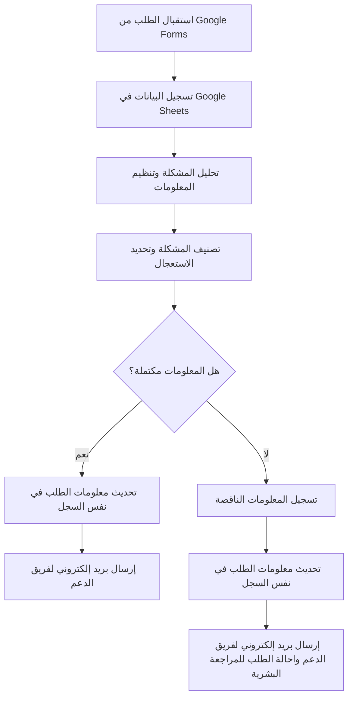

# IT Support Requests Automation System

---

## 1. Process — العملية الأساسية

تتمثل العملية في استقبال طلبات الدعم الفني من موظفي الشركة، والتحقق من اكتمال المعلومات، وفهم المشكلة وتصنيفها، وتحديد درجة اهميتها، ثم توجيه الطلب إلى المسار المناسب.

**الهدف:** تقليل التدخل اليدوي، وتحسين تنظيم الطلبات، وضمان وصولها إلى فريق الدعم الفني بصورة واضحة ومتكاملة.

---

## 2. Workflow — سير العمل

يمر النظام بالمراحل التالية:

1. استقبال الطلب من خلال Google Forms.
3. تحليل وصف المشكلة وتنظيم المعلومات.
4. تصنيف المشكلة وتحديد درجة الأهمية.
5. التحقق من اكتمال المعلومات المطلوبة.
6. تحديد المسار المناسب بناءً على نتيجة التحقق.
7. توجيه الطلب المكتمل إلى مسار الإرسال.
8. توجيه الطلب غير المكتمل إلى مسار المراجعة البشرية.
9. إرسال بريد إلكتروني منظم إلى فريق الدعم الفني.
10. تحديث سجل الطلب بحالته ونتيجة معالجته.

---

## 3. Tasks / Subtasks — المهام والمهام الفرعية

### Task 1: استقبال الطلب (Request Intake)

- استقبال الطلب من Google Forms.
- استخراج بيانات الموظف ووصف المشكلة.
- تسجيل البيانات في Google Sheets.
- إنشاء رقم مرجعي فريد لكل طلب.

### Task 2: فهم المشكلة (Problem Understanding)

- قراءة وصف المشكلة.
- تحديد نوع المشكلة، مثل الأجهزة أو البرامج أو الشبكة أو الحسابات والصلاحيات.
- استخراج المعلومات الأساسية المتعلقة بالمشكلة.
- تحديد درجة الاهمية وفق معايير محددة.

### Task 3: تنظيم المعلومات (Information Processing)

- استخراج البيانات الأساسية من الطلب.
- توحيد تنسيق المعلومات.
- تحديد المعلومات الناقصة أو غير الواضحة.
- إعداد ملخص منظم يتضمن بيانات الموظف ووصف المشكلة ونوعها ودرجة اهميتها.

### Task 4: التحقق من اكتمال المعلومات (Validation)

- التأكد من وجود جميع الحقول المطلوبة.
- التحقق من صحة البيانات الأساسية، مثل البريد الإلكتروني.
- تحديد ما إذا كانت المعلومات كافية لفهم المشكلة ومتابعتها.
- تحديد ما إذا كان الطلب يحتاج إلى مراجعة بشرية.
- تسجيل نتيجة التحقق في Google Sheets.

### Task 5: توجيه الطلب (Request Routing)

- توجيه الطلب المكتمل إلى مسار الإرسال.
- توجيه الطلب الناقص أو غير الواضح إلى مسار المراجعة البشرية.
- تحديد حالة الطلب وفق المسار المختار.
- تسجيل قرار التوجيه في Google Sheets.

### Task 6: إرسال البريد الإلكتروني (Email Notification)

- إعداد بريد إلكتروني منظم يتضمن تفاصيلالموظف / نوع المشكلة / اهمية المشكلة / حالة المشكلة / تفاصيل المشكلة.
- إرسال البريد إلى فريق الدعم الفني.

### Task 7: معالجة الاستثناءات (Exception Handling)

- تحديد الطلبات التي تحتوي على معلومات ناقصة.
- إحالة الطلب إلى المراجعة البشرية.
- منع إرسال الطلبات غير المكتملة باعتبارها طلبات جاهزة.

## 4. Sequence — تسلسل تنفيذ الخطوات

يوضح المخطط التالي ترتيب الخطوات ونقاط اتخاذ القرار في النظام.

### Happy Path — المسار الطبيعي

يحدث عندما يكون الطلب مكتملًا وواضحًا:

1. يرسل الموظف الطلب.
2. يسجل النظام البيانات.
3. يحلل النظام المشكلة ويصنفها.
4. يتحقق النظام من اكتمال المعلومات.
5. يجهز النظام رسالة البريد الإلكتروني.
6. يرسل الرسالة إلى فريق الدعم الفني.
7. يسجل النظام حالة الطلب `Sent` بعد نجاح الإرسال.

### Exception Path — مسار الاستثناءات

يحدث عندما يتعذر إكمال المعالجة التلقائية، ومن أمثلته:

- **معلومات ناقصة:** إحالة الطلب إلى المراجعة البشرية.
- **مشكلة غير واضحة:** طلب مراجعة بشرية بدلًا من فرض تصنيف غير موثوق.

## 5. Dependencies — الاعتماديات

توضح الاعتماديات المهام التي يجب إكمالها قبل بدء مهام أخرى.

| المهمة | تعتمد على | السبب |
|---|---|---|
| تسجيل الطلب | استقبال الطلب | يجب وصول البيانات أولًا |
| فهم المشكلة | تسجيل الطلب | يلزم توفر بيانات الطلب |
| تنظيم المعلومات | فهم المشكلة | يحتاج النظام إلى تحليل الوصف |
| التحقق من الاكتمال | تنظيم المعلومات | يجب تجهيز البيانات قبل فحصها |
| توجيه الطلب | التحقق من الاكتمال | يعتمد المسار على نتيجة التحقق |
| إرسال البريد | اكتمال الطلب واختيار مسار الإرسال | يجب أن يكون الطلب جاهزًا |

---
