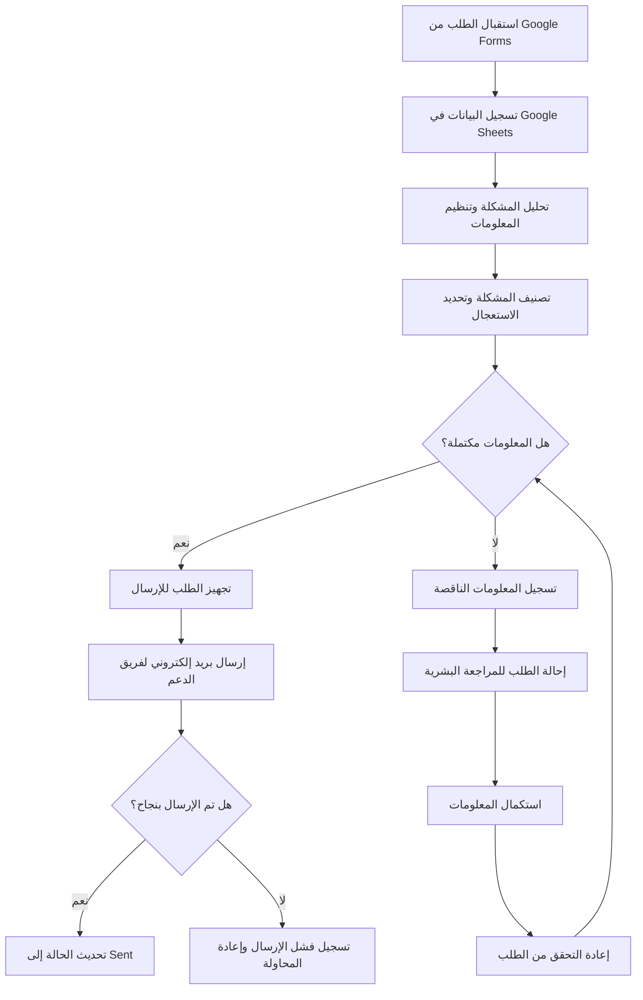

# IT Support Requests Automation System

---

## 1. Process — العملية الأساسية

تتمثل العملية في استقبال طلبات الدعم الفني من موظفي الشركة، والتحقق من اكتمال المعلومات، وفهم المشكلة وتصنيفها، وتحديد درجة استعجالها، ثم توجيه الطلب إلى المسار المناسب.

**الهدف:** تقليل التدخل اليدوي، وتحسين تنظيم الطلبات، وضمان وصولها إلى فريق الدعم الفني بصورة واضحة ومتكاملة.

---

## 2. Workflow — سير العمل

يمر النظام بالمراحل التالية:

1. استقبال الطلب من خلال Google Forms.
2. تسجيل بيانات الطلب في Google Sheets.
3. تحليل وصف المشكلة وتنظيم المعلومات.
4. تصنيف المشكلة وتحديد درجة الاستعجال.
5. التحقق من اكتمال المعلومات المطلوبة.
6. تحديد المسار المناسب بناءً على نتيجة التحقق.
7. توجيه الطلب المكتمل إلى مسار الإرسال.
8. توجيه الطلب غير المكتمل إلى مسار المراجعة البشرية.
9. إرسال بريد إلكتروني منظم إلى فريق الدعم الفني.
10. تحديث سجل الطلب بحالته ونتيجة معالجته.

---

## 3. Tasks / Subtasks — المهام والمهام الفرعية

### Task 1: استقبال الطلب (Request Intake)

- استقبال الطلب من Google Forms.
- استخراج بيانات الموظف ووصف المشكلة.
- تسجيل البيانات في Google Sheets.
- إنشاء رقم مرجعي فريد لكل طلب.

### Task 2: فهم المشكلة (Problem Understanding)

- قراءة وصف المشكلة وتحليله.
- تحديد نوع المشكلة، مثل الأجهزة أو البرامج أو الشبكة أو الحسابات والصلاحيات.
- استخراج المعلومات الأساسية المتعلقة بالمشكلة.
- تحديد درجة الاستعجال وفق معايير محددة.

### Task 3: تنظيم المعلومات (Information Processing)

- استخراج البيانات الأساسية من الطلب.
- توحيد تنسيق المعلومات.
- تحديد المعلومات الناقصة أو غير الواضحة.
- إعداد ملخص منظم يتضمن بيانات الموظف ووصف المشكلة ونوعها ودرجة استعجالها.

### Task 4: التحقق من اكتمال المعلومات (Validation)

- التأكد من وجود جميع الحقول المطلوبة.
- التحقق من صحة البيانات الأساسية، مثل البريد الإلكتروني.
- تحديد ما إذا كانت المعلومات كافية لفهم المشكلة ومتابعتها.
- تحديد ما إذا كان الطلب يحتاج إلى مراجعة بشرية.
- تسجيل نتيجة التحقق في Google Sheets.

### Task 5: توجيه الطلب (Request Routing)

- توجيه الطلب المكتمل إلى مسار الإرسال.
- توجيه الطلب الناقص أو غير الواضح إلى مسار المراجعة البشرية.
- تحديد حالة الطلب وفق المسار المختار.
- تسجيل قرار التوجيه في Google Sheets.

### Task 6: إرسال البريد الإلكتروني (Email Notification)

- إعداد بريد إلكتروني منظم يتضمن تفاصيل الطلب.
- تضمين رقم الطلب وبيانات الموظف وتصنيف المشكلة ودرجة الاستعجال.
- إرسال البريد إلى فريق الدعم الفني.
- تسجيل حالة الإرسال ووقته في Google Sheets.
- تسجيل الأخطاء وإتاحة إعادة المحاولة عند فشل الإرسال.

### Task 7: معالجة الاستثناءات (Exception Handling)

- تحديد الطلبات التي تحتوي على معلومات ناقصة.
- تسجيل سبب الاستثناء.
- إحالة الطلب إلى المراجعة البشرية.
- منع إرسال الطلبات غير المكتملة باعتبارها طلبات جاهزة.
- إعادة معالجة الطلب بعد استكمال المعلومات والتحقق منها.

---

## 4. Sequence — تسلسل تنفيذ الخطوات

يوضح المخطط التالي ترتيب الخطوات ونقاط اتخاذ القرار في النظام.

### Happy Path — المسار الطبيعي

يحدث عندما يكون الطلب مكتملًا وواضحًا:

1. يرسل الموظف الطلب.
2. يسجل النظام البيانات.
3. يحلل النظام المشكلة ويصنفها.
4. يتحقق النظام من اكتمال المعلومات.
5. يجهز النظام رسالة البريد الإلكتروني.
6. يرسل الرسالة إلى فريق الدعم الفني.
7. يسجل النظام حالة الطلب `Sent` بعد نجاح الإرسال.

### Exception Path — مسار الاستثناءات

يحدث عندما يتعذر إكمال المعالجة التلقائية، ومن أمثلته:

- **معلومات ناقصة:** إحالة الطلب إلى المراجعة البشرية.
- **مشكلة غير واضحة:** طلب مراجعة بشرية بدلًا من فرض تصنيف غير موثوق.
- **فشل تسجيل الطلب:** تسجيل الخطأ وإشعار المسؤول عند الحاجة.
- **فشل إرسال البريد:** تسجيل حالة الفشل وإتاحة إعادة المحاولة.

بعد معالجة الاستثناء واستكمال المعلومات، يعود الطلب إلى مسار التحقق.

---

## 5. Dependencies — الاعتماديات

توضح الاعتماديات المهام التي يجب إكمالها قبل بدء مهام أخرى.

| المهمة | تعتمد على | السبب |
|---|---|---|
| تسجيل الطلب | استقبال الطلب | يجب وصول البيانات أولًا |
| فهم المشكلة | تسجيل الطلب | يلزم توفر بيانات الطلب |
| تنظيم المعلومات | فهم المشكلة | يحتاج النظام إلى تحليل الوصف |
| التحقق من الاكتمال | تنظيم المعلومات | يجب تجهيز البيانات قبل فحصها |
| توجيه الطلب | التحقق من الاكتمال | يعتمد المسار على نتيجة التحقق |
| إرسال البريد | اكتمال الطلب واختيار مسار الإرسال | يجب أن يكون الطلب جاهزًا |
| تحديث حالة الإرسال | نتيجة محاولة الإرسال | لتسجيل النجاح أو الفشل |
| المراجعة البشرية | اكتشاف نقص أو غموض | لمعالجة الاستثناء |
| إعادة المعالجة | استكمال المعلومات | يجب إعادة التحقق قبل الإرسال |

---

## 6. Request Status — حالات الطلب

يمكن استخدام الحالات التالية لتتبع الطلبات في Google Sheets:

| الحالة | المعنى |
|---|---|
| `Received` | تم استقبال الطلب |
| `Processing` | جارٍ تحليل الطلب |
| `Needs Human Review` | يحتاج إلى مراجعة بشرية |
| `Ready to Send` | الطلب مكتمل وجاهز للإرسال |
| `Sent` | تم إرسال البريد بنجاح |
| `Send Failed` | فشل إرسال البريد |
| `Completed` | أُغلقت معالجة الطلب بعد متابعة فريق الدعم |

**ملاحظة:** حالة `Sent` تعني أن البريد أُرسل بنجاح، ولا تعني أن المشكلة التقنية قد حُلّت.

---

## 7. Tools — الأدوات المقترحة

| الأداة | الاستخدام |
|---|---|
| Google Forms | استقبال طلبات الموظفين |
| Google Sheets | تخزين الطلبات ومتابعة حالاتها |
| Make أو n8n | ربط الخدمات وتنفيذ خطوات الأتمتة |
| Gmail | إرسال الطلبات المنظمة إلى فريق الدعم |
| أداة ذكاء اصطناعي (اختيارية) | فهم وصف المشكلة وتصنيفها |

يمكن تنفيذ التحقق من الحقول باستخدام قواعد ثابتة، بينما يمكن استخدام الذكاء الاصطناعي لفهم وصف المشكلة وتصنيفها عند الحاجة.

---

## 8. Success Criteria — معايير النجاح

يُعتبر النظام ناجحًا إذا حقق المعايير التالية:

- تقليل الوقت والجهد المبذولين في معالجة الطلبات الأولية.
- تسجيل جميع الطلبات المقدمة عبر النموذج.
- التحقق من اكتمال الحقول المطلوبة.
- تصنيف المشكلات بدقة مقبولة.
- إرسال الطلبات المكتملة إلى فريق الدعم الفني بتنسيق واضح.
- تسجيل حالات الإرسال والأخطاء.
- إتاحة مراجعة الطلبات الناقصة ومتابعتها.

---

## 9. Project Goal — هدف المشروع

أتمتة عملية استقبال طلبات الدعم الفني والتحقق من بياناتها وتصنيفها وتنظيمها وإرسالها إلى الفريق المختص، بهدف تقليل العمل اليدوي وتحسين كفاءة التعامل مع المشكلات التقنية.
